 

  

**3DTrcek** is the 3D printing brand of **Plastika Trček**, a family-run polymer processing company from Ljubljana, Slovenia, with more than 55 years of experience in plastics.

We don't rebrand someone else's spools. We compound the material, extrude it, spool it and check it ourselves — so we know exactly what goes into every kilogram, and we can keep it consistent from one order to the next.

A selection of our range — see <a href="https://3dtrcek.com">3dtrcek.com</a> for every material and colour.

Print with a printer we don't run in-house? **[Share your profile](https://github.com/3DTrcek/3DTrcek-filament-profiles/issues/new/choose)** — fill in a short form, drop in your exported profile, and help the next person get it right on the first print.

<b>Official</b> = tuned and tested by us. <b>Community</b> = shared by users — your slicer isn't covered yet? Be the first to add it.

<b>How do I import a profile into my slicer?</b>

 

- **Bambu Studio / OrcaSlicer / QIDI Studio / ElegooSlicer / Creality Print:** File → Import → Import Configs… and pick the `.json` file.
- **PrusaSlicer / SuperSlicer:** File → Import → Import Config… and pick the `.ini` file.
- **UltiMaker Cura:** Preferences → Configure Cura → Profiles → Import, and pick the `.curaprofile` file.

Full instructions are in the [profiles repository](https://github.com/3DTrcek/3DTrcek-filament-profiles#how-to-install-a-profile).

<b>My printer or slicer isn't in the library. What should I use?</b>

 

Start from your slicer's generic preset for the same material (e.g. *Generic PETG*) and set the temperatures from the technical data sheet on the product page at [3dtrcek.com](https://3dtrcek.com). Then run a temperature tower and a flow test. Once you're happy with it, please [share it](https://github.com/3DTrcek/3DTrcek-filament-profiles/issues/new/choose) so the next person doesn't have to start from zero.

<b>How do I share my own profile? Do I need to know Git?</b>

 

No. Open the [submission form](https://github.com/3DTrcek/3DTrcek-filament-profiles/issues/new/choose), fill in your printer, nozzle and key settings, and drag in the exported file. We review it and add it to the library with your name on it. If you do use Git, pull requests are welcome too.

<b>Are community profiles tested by 3DTrcek?</b>

 

Official profiles are tuned on our own printers. Community profiles are tested by the person who shared them — we check that the file is complete and sensible, but printers, nozzles and room conditions vary, so treat them as a strong starting point.

<b>Where do I find print temperatures and technical data?</b>

 

Every product page on [3dtrcek.com](https://3dtrcek.com) has the recommended settings and a technical data sheet.

<b>Do you sell in bulk or to businesses?</b>

 

Yes — we supply makers, print farms and companies across Europe. Get in touch at [info@3dtrcek.com](mailto:info@3dtrcek.com).

Plastika Trček d.o.o. · Ljubljana, Slovenia · Made in the EU

